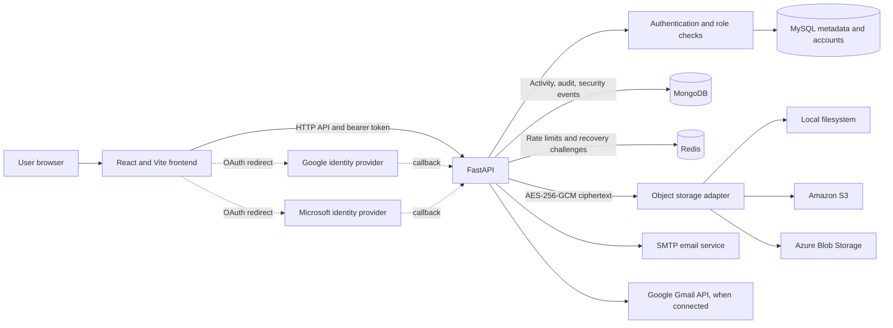
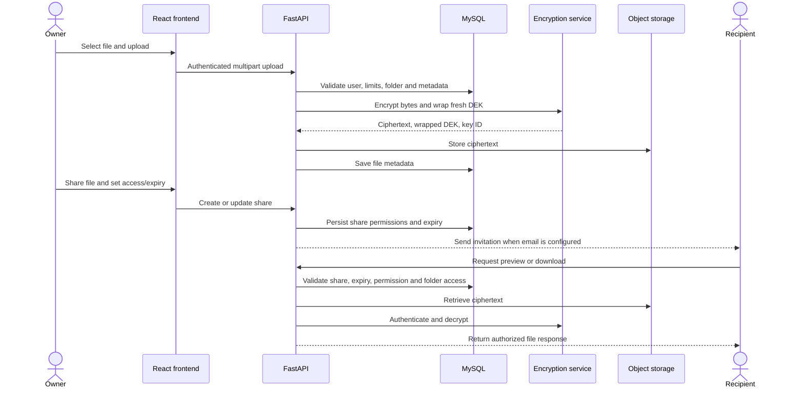

# TrustShare

**Intelligent Encrypted File Sharing and Digital Collaboration Management Platform**

TrustShare is a web application for managing files and folders, sharing them with controlled access, and reviewing account and security activity. Its React frontend calls a FastAPI backend. The backend stores file metadata in MySQL, activity and security records in MongoDB, rate-limit and short-lived challenge state in Redis, and encrypted file objects on local disk, Amazon S3, or Azure Blob Storage.

> This repository contains an actively developed application and automated tests. It is not presented as production-ready. Deployment security depends on correct secret management, provider configuration, infrastructure hardening, database migrations, and operational review.

## What the project provides

- Email and password registration and login, plus Google and Microsoft OAuth sign-in and account linking when configured.
- User workspaces for upload, download, file and folder organization, favorites, recent activity, and storage views.
- File and folder sharing with recipient permissions, expiration, updates, and revocation.
- AES-256-GCM encryption for new file payloads, with per-file data-encryption keys wrapped by a configured key-encryption key.
- Local, S3, and Azure Blob object-storage adapters.
- Password recovery flows with emailed verification codes, attempt controls, and Redis-backed challenge state.
- Super-administrator views for platform overview, users, system health, security, file activity, and sharing reports; persisted policy settings and file-key rotation tools.
- MongoDB activity/audit records, security-event monitoring, notifications, analytics, and share-expiry reminder processing.

Feature availability depends on environment configuration, database state, provider setup, and the permissions of the signed-in role.

## Roles and access

The backend recognizes `user`, `admin`, `super_admin`, and `guest`. Unknown stored role values fall back to `user`. Protected handlers enforce roles on the server; hiding a frontend view alone does not grant or deny access.

| Role | Verified responsibility |
|---|---|
| User | Own files and folders, personal workspace, and shares available to their account. |
| Admin | A recognized role. Monitoring endpoints use administrator authorization where annotated; the `/admin` platform-management router is specifically super-admin protected. |
| Super admin | Platform overview, user/security administration, platform settings, key rotation, and other `/admin` management routes. |
| Guest | A recognized role, with access limited to routes that explicitly allow it. |

The repository does not document a complete permission matrix for every role and action; consult the route dependencies before extending or deploying role policies.

## Technology stack

| Area | Implementation |
|---|---|
| Frontend | React 19, React Router, Axios, Vite |
| Backend | Python, FastAPI, Uvicorn, Pydantic, SQLAlchemy |
| Relational data | MySQL 8, accessed through PyMySQL |
| Activity and audit data | MongoDB, through PyMongo |
| Rate limits and temporary state | Redis |
| File encryption | `cryptography`: AES-GCM and Fernet key wrapping |
| Object storage | Local filesystem, Amazon S3 (`boto3`), Azure Blob Storage (`azure-storage-blob` and `azure-identity`) |
| Identity and email | Authlib OAuth clients for Google/Microsoft; SMTP email and Google Gmail integration |
| Local infrastructure | Docker Compose for MySQL, MongoDB, and Redis |
| Automated checks in repository | Python tests via pytest; Playwright browser specs; ESLint and Vite build scripts |

## Architecture


### **Frontend**

The Vite entry point is `frontend/src/main.jsx`; `frontend/src/App.jsx` defines the React Router routes and contains the landing, login/registration, account, dashboard, shared-file, and related screens. `admindashboard.jsx` and `SecureAdminDashboard.jsx` provide administrator UI. `frontend/src/api.js` centralizes Axios calls, adds a bearer token from browser `sessionStorage`, sends credentialed requests, and redirects to login when an authenticated request receives HTTP 401.

`VITE_API_URL` selects the backend base URL; the code defaults to `http://localhost:8000`.

Styling is maintained in the app's CSS files. The project does not include a separate Redux-style state store; screens use React component state and API helpers. PDF, DOCX, and PowerPoint preview renderers are implemented in the frontend.

### **Backend request flow**

FastAPI loads `backend/.env`, configures session and CORS middleware, and registers routers from `backend/app/main.py`. Authenticated endpoints resolve the bearer JWT to a current MySQL user and validate the token's password-version claim. Role dependencies gate privileged operations. Handlers validate request data, check ownership/share/folder conditions, access metadata in MySQL, then use MongoDB/Redis and the configured object-storage adapter as needed. New uploads are encrypted before the object is written; authorized download and preview paths retrieve and decrypt content before returning it. Activity/notification work is recorded alongside the relevant operation, with some download activity attached as a response background task.

## **Authentication and security controls**

- Local passwords are hashed with `pwdlib`'s recommended password hash. JWT bearer tokens are signed using configured `JWT_SECRET_KEY` and `JWT_ALGORITHM`; tokens include expiry and a password-version value. Changing the password invalidates previously issued tokens when their version no longer matches.
- Google and Microsoft OAuth clients are registered when their client ID and secret are configured. Gmail authorization is a separate Google integration used for Gmail-backed delivery. These flows require provider-side redirect URI configuration.
- Login/authentication throttling uses Redis counters and configurable attempt windows. Password-recovery challenges and one-time codes also use Redis-backed state, digests, and attempt/consumption checks.
- File and folder authorization is enforced in backend routes. File shares support permission and expiration updates and can be revoked. Folder access has its own share/access handlers; password-protected folders use password hashes and unlock checks.
- Activity and security events are persisted in MongoDB. Notification, audit-history, suspicious-activity, and administrator analytics endpoints are implemented.
- Starlette session middleware is configured, and the frontend sends credentials, but the primary frontend API authentication mechanism is the bearer token stored in browser `sessionStorage`. Use HTTPS in deployed environments and review cookie, token, CORS, secret, OAuth, and logging settings for the target deployment.

These controls do not by themselves establish a production security posture. In particular, deployment configuration and access to the wrapping keys determine whether encrypted files can be recovered and who can decrypt them.

## **File encryption, storage, and sharing**

For new uploads, `backend/app/services/encryption_service.py` generates a fresh 256-bit data-encryption key (DEK) and 12-byte nonce, encrypts bytes with AES-256-GCM, and authenticates the `TSFILE01` format marker as associated data. The DEK is wrapped with a Fernet key-encryption key (KEK). The file record stores encryption version, wrapped DEK, key identifier, and storage backend; ciphertext is stored through the configured adapter. Key rotation rewraps DEKs while leaving file ciphertext unchanged.

Local files are written under `backend/uploads`. S3 and Azure receive encrypted object bytes. S3 writes also request server-side AES256 encryption. A valid keyring must remain available to decrypt objects; losing a required KEK can make corresponding files unrecoverable. Keep keys out of source control and retain old keys until rotation is complete.

Legacy version-0 objects are distinct from encrypted new uploads. The download path blocks legacy plaintext objects by default when encryption metadata indicates they should be encrypted; a legacy-download override exists for migration scenarios. Review and migrate old data deliberately before relying on the setting.

The file workflow is represented below; exact authorization checks depend on whether the request is for an owner file, a shared file, or a protected folder.


## **Preview support and limits**

The backend exposes previews only for the following extension allowlist: `.pdf`, `.docx`, `.png`, `.jpg`, `.jpeg`, `.gif`, `.webp`, `.pptx`, and `.ppt`. The frontend contains corresponding PDF, Word, presentation, and image renderers. Preview requests still go through backend authentication/share checks and decryption. Uploading a file does not imply that TrustShare can preview it. Other allowed upload types, including `.doc`, `.txt`, `.xls`, `.xlsx`, `.csv`, `.svg`, and `.zip` in the default configuration, are not in the preview allowlist.

The default upload extension list, maximum upload size, and per-user quota are configurable and may also be bounded by persisted platform settings.

## **Data and integrations**

| Component          | Responsibility                                                                                                                                                                                           |
| ------------------ | -------------------------------------------------------------------------------------------------------------------------------------------------------------------------------------------------------- |
| MySQL              | Users, linked OAuth providers, file/folder metadata, shares, favorites, Gmail credential records, platform settings, and relational state. SQLAlchemy models are in `backend/app/models.py`.             |
| MongoDB            | Activity records and derived audit/security/notification data used by monitoring features. The default database name is `trustshare`; `backend/app/activity.py` defines collection behavior and indexes. |
| Redis              | Authentication rate-limit counters and expiring recovery/challenge state. Redis is also used for atomic challenge operations.                                                                            |
| Local filesystem   | Development object storage under `backend/uploads`; objects are encrypted for new uploads.                                                                                                               |
| Amazon S3          | Optional object storage, selected using `FILE_STORAGE_BACKEND=s3`; uses the AWS SDK credential chain and `S3_BUCKET`, with optional `AWS_REGION`.                                                        |
| Azure Blob Storage | Optional object storage, selected using `FILE_STORAGE_BACKEND=azure`; uses `DefaultAzureCredential`, an account name or URL, and a container.                                                            |
| SMTP               | Optional email transport for notifications and recovery; configure host, port, sender, and credentials/TLS as appropriate.                                                                               |
| Google OAuth/Gmail | Optional sign-in/account linking and Gmail sending. Gmail credentials are encrypted before persistence; configure Google OAuth and token-encryption settings.                                            |
| Microsoft OAuth    | Optional sign-in and account linking when Microsoft client configuration is supplied.                                                                                                                    |

There is no Redis, MongoDB, or storage service container for cloud providers in Compose. `docker-compose.yml` starts only MySQL, MongoDB, and Redis; the application is run separately.

## **API overview**

The API is defined by the active routers in `backend/app`. The following groups summarize their purpose; use OpenAPI for the complete request/response schemas and current endpoint list.

| Prefix or group       | Purpose                                                                                                            | Access                                                                                                                  |
| --------------------- | ------------------------------------------------------------------------------------------------------------------ | ----------------------------------------------------------------------------------------------------------------------- |
| `/auth`               | Register/login, current-user/logout, Google and Microsoft OAuth, account linking, Gmail status/connect callbacks.  | Login and OAuth entry points are public; account operations require authentication.                                     |
| `/recovery`           | Account password recovery and recovery of protected resources using emailed codes.                                 | Public recovery start/verify/reset flows with challenge authorization; resource recovery includes authenticated routes. |
| `/security`           | Security/configuration status.                                                                                     | Authenticated.                                                                                                          |
| `/files`              | Upload/list/download/preview/delete/move, favorites, shares, shared-with-me, dashboard activity/analytics.         | Authenticated except tokenized shared-file entry points as implemented.                                                 |
| `/folders`            | Create/list/rename/delete/unlock folders and manage folder access.                                                 | Authenticated, with folder-owner/share and unlock checks.                                                               |
| `/admin`              | Super-admin overview, user management, security dashboards, system health, files, analytics, and sharing reports.  | Super admin.                                                                                                            |
| `/admin/settings`     | Read/update persisted platform policy settings.                                                                    | Super admin.                                                                                                            |
| `/admin/key-rotation` | Preview and apply encryption key rotation.                                                                         | Super admin.                                                                                                            |
| Monitoring routes     | User notifications; admin notifications, audit logs, security events, and storage/file/download/sharing analytics. | User-owned notification routes require authentication; administrative routes require admin authorization.               |
| `/`, `/health`        | Basic API and health responses.                                                                                    | Public.                                                                                                                 |

Monitoring routes are registered at the API root: notification actions include `GET /notifications`, `POST /notifications/{notification_id}/read`, and `POST /notifications/read-all`; administrator endpoints include `/audit-logs`, `/security-events`, and `/analytics/{storage,users/storage,files,downloads,sharing}`. Activity, audit, notification, and security-event data use MongoDB collections named `activity_logs`, `audit_logs`, `notifications`, and `security_events`. The admin UI implements server-backed filtering for relevant activity/audit/security/report views. The FastAPI lifespan runs an expiry reminder loop (60 seconds by default, configurable with `SHARE_EXPIRY_REMINDER_INTERVAL_SECONDS`) and creates deduplicated reminder notifications for expiring active shares; email delivery still depends on configuration.

FastAPI's default interactive OpenAPI UI is available at `http://localhost:8000/docs`, with the schema at `/openapi.json` and ReDoc at `/redoc` when the service is running.

## **Repository layout**

```
.
├── backend/
│   ├── app/
│   │   ├── main.py                  # FastAPI app, startup, middleware, router registration
│   │   ├── routes_*.py              # Authentication, files, folders, recovery, admin, monitoring
│   │   ├── auth.py                  # JWT, password hashing, role dependencies, OAuth clients
│   │   ├── database.py              # MySQL, MongoDB, Redis connections
│   │   ├── models.py, schemas.py    # SQLAlchemy models and Pydantic schemas
│   │   ├── services/                # Encryption and object-storage adapters
│   │   ├── activity.py              # Activity, audit, notification, and security event helpers
│   │   └── *_migration*.py           # Schema and legacy/key migration utilities
│   ├── migrations/                   # SQL/Python migration scripts
│   ├── tests/                        # Backend unit and route tests
│   ├── requirements.txt
│   └── .env.example                 # Variable names and safe example configuration
├── docs/
│   └── MILESTONE_2_AND_3_VERIFICATION.md
├── frontend/
│   ├── src/                          # React screens, dashboards, API client, styles, renderers
│   ├── e2e/                           # Playwright browser workflow specs
│   ├── package.json
│   └── vite.config.js
├── docker-compose.yml                 # MySQL, MongoDB, Redis for local development
├── LICENSE
└── README.md
```
Generated output, dependencies, caches, and backup copies are intentionally omitted from this overview.

## **Requirements**

- Git
- Python 3.12 (use a compatible Python version for the project's dependencies)
- Node.js and npm
- Docker Desktop with Docker Compose, or separately managed MySQL 8, MongoDB, and Redis services

Optional: Google/Microsoft OAuth credentials, SMTP or Gmail delivery configuration, and cloud object-storage identity and permissions.

## **Local setup**

Run commands from the repository root unless a command changes directories. The Compose file publishes MySQL on host port `3307`, MongoDB on `27017`, and Redis on `6379`. Configure the backend's MySQL host/port/user/database to match your local service. Compose includes development-only database credentials in its configuration; do not reuse them outside a local environment.

### **1. Start databases**

```
docker compose up -d mysql mongodb redis
```
### **2. Create and configure the backend environment**

```
Copy-Item backend\.env.example backend\.env
```
Edit `backend\.env` locally. Supply a strong random `JWT_SECRET_KEY` (at least 32 characters), a local MySQL connection, and a valid file key-encryption key before starting the API. The `.env` file is ignored by Git. Never copy real credentials into this README or commit them.

Create a virtual environment and install dependencies:

```
py -3.12 -m venv backend\.venv
backend\.venv\Scripts\python.exe -m pip install --upgrade pip
backend\.venv\Scripts\python.exe -m pip install -r backend\requirements.txt
```
### **3. Start the backend**

```
Set-Location backend
.\.venv\Scripts\python.exe -m uvicorn app.main:app --reload
```
FastAPI startup checks connections to all three databases, creates SQLAlchemy tables, runs the application's startup schema checks, and starts the expiry-reminder loop. Apply the SQL migration scripts in `backend/migrations` as required for an existing database; startup helpers do not replace review of every migration. API: `http://localhost:8000`; OpenAPI UI: `http://localhost:8000/docs`.

### **4. Install and start the frontend**

In a second PowerShell terminal from the repository root:

```
Set-Location frontend
npm install
npm run dev
```
Vite normally serves at `http://localhost:5173`. To use another backend URL, create `frontend/.env.local` with `VITE_API_URL` set to that URL, then restart Vite. The backend CORS configuration currently allows the localhost origins on port 5173.

## **Environment configuration**

`backend/.env.example` is the reference for names. Requirements depend on enabled features; values below describe usage and the code's defaults, not secret values.

| Variables                                                                                                                                                                         | Required when                                                               | Purpose                                                                                                                    |
| --------------------------------------------------------------------------------------------------------------------------------------------------------------------------------- | --------------------------------------------------------------------------- | -------------------------------------------------------------------------------------------------------------------------- |
| `MYSQL_HOST`, `MYSQL_PORT`, `MYSQL_DATABASE`, `MYSQL_USER`, `MYSQL_PASSWORD`                                                                                                      | Always                                                                      | MySQL SQLAlchemy connection. The connection string is assembled from these values.                                         |
| `MONGODB_URI`, `MONGODB_DB`                                                                                                                                                       | MongoDB is used; URI defaults to local MongoDB and database to `trustshare` | Activity and monitoring persistence.                                                                                       |
| `REDIS_HOST`, `REDIS_PORT`, `REDIS_DB`                                                                                                                                            | Redis-backed limits/challenges are used; host/port/db default locally       | Redis connection.                                                                                                          |
| `JWT_SECRET_KEY`                                                                                                                                                                  | Always                                                                      | JWT signing and session middleware secret; must be at least 32 characters.                                                 |
| `JWT_ALGORITHM`, `ACCESS_TOKEN_EXPIRE_MINUTES`, `SESSION_COOKIE_SECURE`                                                                                                           | Optional                                                                    | JWT algorithm, access-token lifetime, and secure session-cookie behavior.                                                  |
| `FILE_KEY_ENCRYPTION_KEY` or `FILE_KEY_ENCRYPTION_KEYS` plus `FILE_KEY_ENCRYPTION_ACTIVE_KEY_ID`                                                                                  | Encrypted file storage                                                      | Single-key or JSON keyring configuration for wrapping file DEKs. Keep keys private and backed up.                          |
| `FILE_STORAGE_BACKEND`                                                                                                                                                            | Optional; defaults to `local`                                               | Select `local`, `s3`, or `azure`.                                                                                          |
| `S3_BUCKET`, `AWS_REGION`                                                                                                                                                         | S3 selected                                                                 | Bucket and optional AWS region; credentials come from the AWS SDK credential chain.                                        |
| `AZURE_STORAGE_CONTAINER`, `AZURE_STORAGE_ACCOUNT_NAME` or `AZURE_STORAGE_ACCOUNT_URL`                                                                                            | Azure selected                                                              | Blob container/account. Authentication uses Azure `DefaultAzureCredential`.                                                |
| `GOOGLE_CLIENT_ID`, `GOOGLE_CLIENT_SECRET`, `GOOGLE_REDIRECT_URI`                                                                                                                 | Google sign-in/linking                                                      | OAuth client and callback configuration.                                                                                   |
| `MICROSOFT_CLIENT_ID`, `MICROSOFT_CLIENT_SECRET`, `MICROSOFT_TENANT`, `MICROSOFT_REDIRECT_URI`, `MICROSOFT_LINK_REDIRECT_URI`                                                     | Microsoft sign-in/linking                                                   | OAuth client, tenant, and callback configuration.                                                                          |
| `GOOGLE_GMAIL_REDIRECT_URI`, `GOOGLE_TOKEN_ENCRYPTION_KEY`                                                                                                                        | Gmail connection                                                            | Gmail OAuth callback and encryption of saved Gmail credentials.                                                            |
| `SMTP_HOST`, `SMTP_PORT`, `SMTP_FROM`, `SMTP_USERNAME`, `SMTP_PASSWORD`, `SMTP_USE_TLS`, `SMTP_USE_SSL`                                                                           | SMTP email delivery                                                         | SMTP endpoint, sender, optional credentials, and transport security.                                                       |
| `FRONTEND_URL`                                                                                                                                                                    | OAuth/email links outside localhost                                         | Frontend redirect and invitation URL base.                                                                                 |
| `AUTH_RATE_LIMIT_MAX_ATTEMPTS`, `AUTH_RATE_LIMIT_WINDOW_SECONDS`                                                                                                                  | Optional                                                                    | Authentication request throttling.                                                                                         |
| `MAX_UPLOAD_SIZE_BYTES`, `USER_STORAGE_QUOTA_BYTES`, `ALLOWED_FILE_EXTENSIONS`                                                                                                    | Optional                                                                    | Upload and quota ceilings and allowed upload extensions. Defaults are 100 MiB, 4 GiB, and a source-defined extension list. |
| `SECURITY_ALERT_ADMIN_IDS`, `SECURITY_ALERT_EMAILS`, `FAILED_LOGIN_THRESHOLD`, `DOWNLOAD_THRESHOLD`, `UNAUTHORIZED_THRESHOLD`, `EXPIRED_LINK_THRESHOLD`, `REVOKED_LINK_THRESHOLD` | Optional                                                                    | Security-event alert targets and thresholds.                                                                               |
| `SHARE_EXPIRY_REMINDER_INTERVAL_SECONDS`                                                                                                                                          | Optional                                                                    | Expiry reminder polling interval; code enforces a minimum of 60 seconds.                                                   |
| `ALLOW_LEGACY_PLAINTEXT_DOWNLOADS`                                                                                                                                                | Legacy migration only                                                       | Explicit legacy download override; leave disabled unless a controlled migration requires it.                               |

Use `backend/.env.example` and source defaults as the final reference. Do not place private values in frontend variables: Vite variables are bundled into browser code.

## **Docker and infrastructure**

`docker-compose.yml` defines only the three local data services and persistent volumes. It does not build or run the application. Start and stop those services with:

```
docker compose up -d mysql mongodb redis
docker compose down
```
The Compose MySQL host port is `3307`, while the container listens on `3306`; use the host port from the backend process running on Windows. Compose values are for local development, and the published database ports should not be exposed to untrusted networks.

## **Testing and verification**

Automated test and verification assets are present in `backend/tests`, `frontend/e2e`, and the npm scripts (`lint`, `build`). The repository also contains `docs/MILESTONE_2_AND_3_VERIFICATION.md`. This README does not claim that these checks have been run in the current environment.

To run backend tests from the repository root:

```
backend\.venv\Scripts\python.exe -m pytest backend\tests -q
```
Frontend lint/build:

```
Set-Location frontend
npm run lint
npm run build
```
Playwright browser specs are configured in `frontend/playwright.config.js`; inspect that configuration and required services before running them.

## **Known limitations and operational notes**

- OAuth, Gmail, SMTP, Azure, and S3 functionality requires provider credentials, correct callbacks/permissions, and external configuration; presence of code does not mean a deployment is connected.
- MySQL, MongoDB, and Redis connections are all checked at API startup, so all three must be reachable even when a particular feature is not being exercised.
- Database migrations are a mixture of SQL/Python scripts and startup schema helpers. Review and back up data before applying migrations or legacy-file utilities.
- Preview support is limited to the explicit allowlist above. Preview conversion quality depends on browser libraries and file contents.
- Legacy plaintext files need a deliberate migration and key-recovery plan. Key loss can make encrypted file contents unavailable.
- The expiry reminder task runs in each API process. Multi-process deployments should consider duplicate scheduler execution and notification idempotency behavior.
- Local development CORS origins and Compose port mappings are fixed in the checked-in configuration and may need deployment-specific changes.
- The repository does not include deployment manifests, a production container image, screenshots, or an end-to-end production hardening guide.

## **Future work**

The repository's verification notes describe milestone work, not a binding roadmap. Potential follow-up work includes deployment-specific infrastructure, documented operational backup/restore and key recovery procedures, broader end-to-end coverage, and deployment-aware scheduling. Treat these as suggestions unless adopted by maintainers.

## **Screenshots**

No application screenshots are included in the repository. Add reviewed screenshots here when they are available.

## **License**

The repository includes a MIT License.