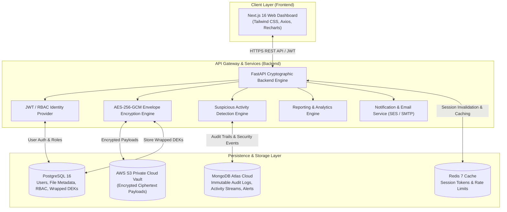
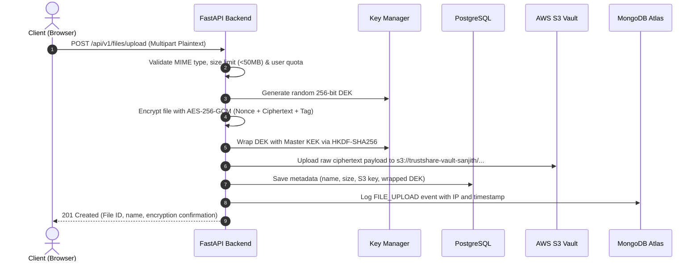
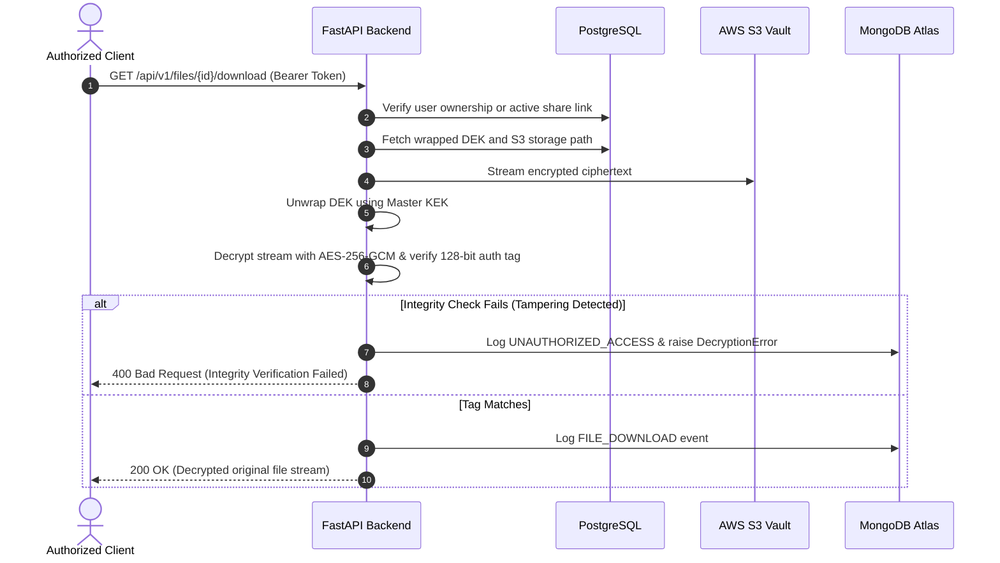

# TrustShare Architecture & System Design Documentation

---

## 1. System Overview

**TrustShare** is an enterprise-grade intelligent encrypted file-sharing and digital collaboration management platform designed around zero-trust cryptographic guarantees, multi-cloud persistence, and real-time security observability.



---

## 2. Multi-Database Architecture

TrustShare leverages a polyglot persistence model to maximize performance, scalability, and audit compliance:

| Database | Role | Schema / Collection Structure | Key Responsibilities |
| :--- | :--- | :--- | :--- |
| **PostgreSQL 16** | Relational System of Record | `users`, `files`, `share_links`, `notifications`, `audit_logs` | ACID transactions, user identity, file metadata, temporal share link validation, wrapped DEK storage. |
| **MongoDB Atlas** | High-Throughput Event Store | `activity_logs`, `audit_logs`, `security_alerts`, `email_dispatches` | Flexible document logging, immutable audit records, time-series threat detection queries, and telemetry aggregation. |
| **Redis 7** | In-Memory Cache | Key-value store | Token revocation blacklists, rapid session lookups, and brute-force rate-limiting. |
| **AWS S3** | Cloud Object Storage | Bucket: `trustshare-vault-sanjith` | Encrypted ciphertext storage. Zero plaintext bytes ever touch cloud storage. |

---

## 3. End-to-End File Upload and Download Flows

### 3.1 Upload Flow (Encrypt-Before-Store)


### 3.2 Download Flow (Decrypt-In-Memory)


---

## 4. Security Observability & Anomaly Detection

The Suspicious Activity Detection Engine continuously processes incoming events against rule thresholds:

```
+-------------------------------------------------------------------------------+
|                       SUSPICIOUS ACTIVITY DETECTION RULES                     |
+-------------------------------------------------------------------------------+
| 1. Brute-Force Logins     : > 5 failed attempts in 10 minutes  --> HIGH       |
| 2. Unauthorized Access    : >= 3 unauthorized attempts in 15m  --> HIGH       |
| 3. Excessive Downloads    : > 20 downloads in 5 minutes        --> MEDIUM     |
| 4. Expired Link Access    : Any access attempt to expired link --> MEDIUM     |
| 5. Revoked Link Access    : Any access attempt to revoked link --> HIGH       |
+-------------------------------------------------------------------------------+
```

When a rule triggers:
1. A permanent alert is stored in PostgreSQL and MongoDB.
2. In-app notifications are created for administrators.
3. Automated security notification emails are dispatched via AWS SES / SMTP.
4. The Admin Dashboard reflects the threat in real-time with severity categorization.

